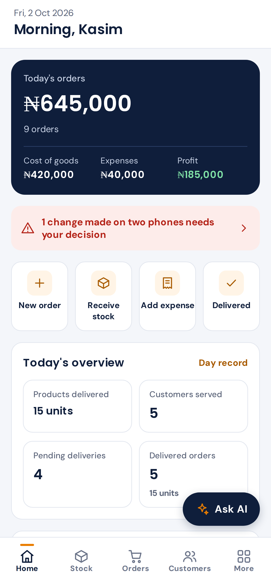
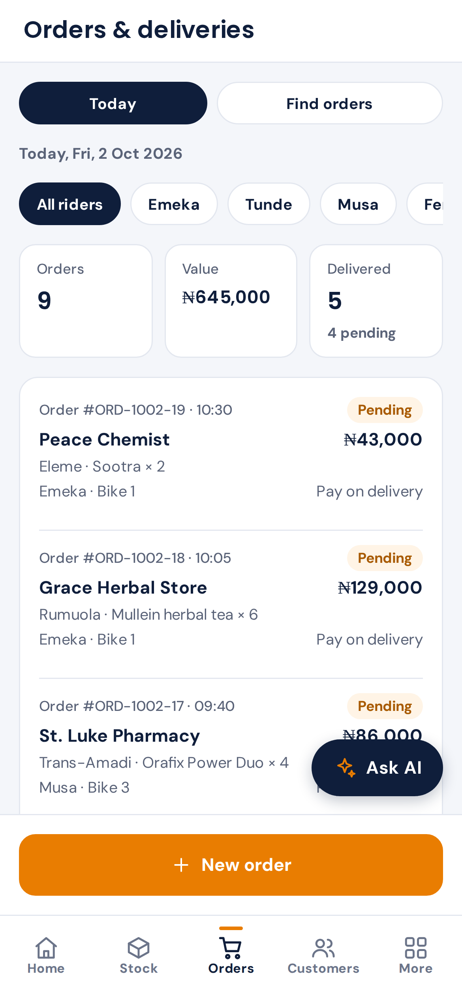
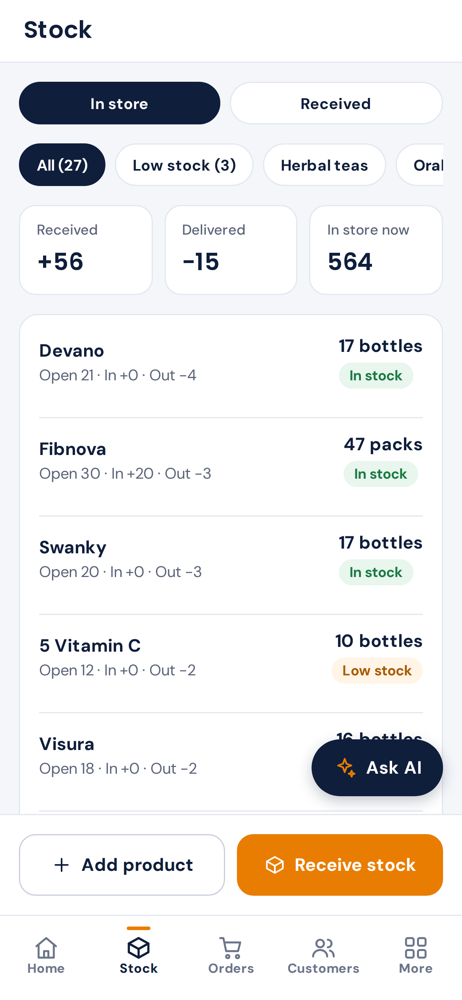
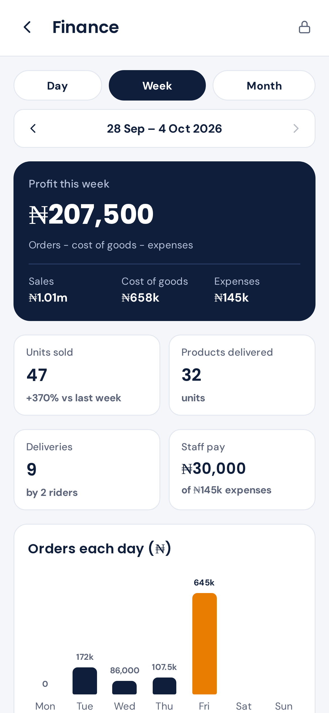
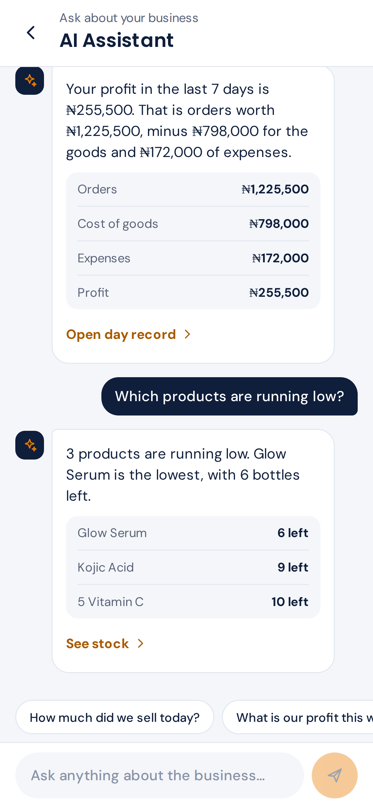
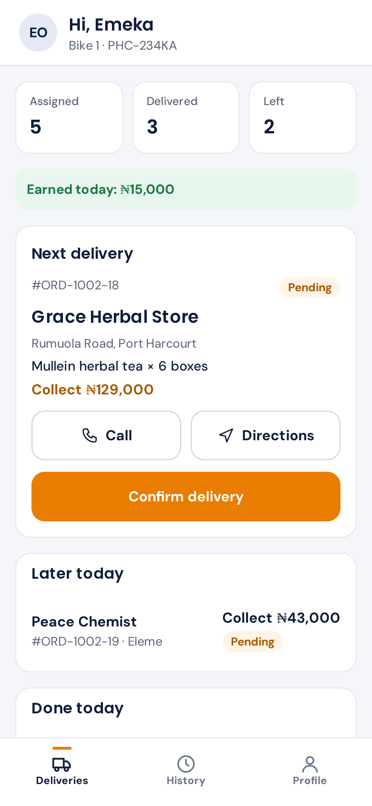

# K-logistics Hub

[](https://github.com/adeniyi-faith/K-logistics-Hub/actions/workflows/check.yml)


A phone app that runs a small delivery business from end to end: orders, stock, riders, expenses, daily profit and an AI assistant you can ask questions about the business. It works with no internet, then syncs when the phone is back online.

It was built for K-logistics Hub Ltd in Port Harcourt, Nigeria. The company sells herbal and health products and delivers them with its own motorbike riders. Before the app, orders lived in notebooks and WhatsApp chats, and nobody could say for sure what was in stock or whether the day had made a profit.

| Owner's home screen | Orders today | Stock |
|---|---|---|
|  |  |  |

| Finance | AI assistant | Rider's home screen |
|---|---|---|
|  |  |  |

## What it does

- **Three kinds of users, three home screens.** The owner (Admin) sees everything. Staff see only the areas they're allowed to. Riders see their deliveries and their earnings.
- **Orders and delivery proof.** Every order records who took it, which rider delivered it and who received it, with an optional photo as proof.
- **Stock.** Each product shows opening stock + received − delivered = closing stock, with low-stock alerts, stock counts and a five-day history.
- **Money.** Expenses with receipt photos, profit by day, week or month, rider earnings, staff pay, and reports you can save as PDF or Excel.
- **Close the day.** The owner locks a day's figures so they can't be changed by accident.
- **Per-person access.** Staff roles (Manager, Accounts, Store keeper and so on) with Off / View / Edit for each area. The server enforces the same rules, so hiding a button is never the only protection.
- **AI assistant.** The owner can ask things like "which product sold best this week?". The question goes to Google's Gemini through a Supabase function that keeps the API key off the phone.
- **Works offline.** Riders often have no signal. Everything is saved on the phone first and sent to the server later.

More screenshots are in [docs/screenshots](docs/screenshots).

## Built with

| Part | Choice |
|---|---|
| App | Expo (SDK 57), React Native, Expo Router, TypeScript |
| On the phone | SQLite (`expo-sqlite`) holding a full local copy of the data |
| Server | Supabase: Postgres database, sign-in, file storage, edge functions |
| Sync | Written from scratch for this project (see below) |
| AI | Gemini, called from a Supabase edge function |
| Build and release | EAS Build, started from a GitHub Action |

## Try it

You need Node.js 22 or newer.

```bash
cd app
npm install
npm run web
```

On the sign-in page, tap **Admin** or **Rider** under "Demo". The demo uses made-up sample data stored in the browser, so no accounts or setup are needed. To use the real synced app on a phone, follow [docs/SETUP.md](docs/SETUP.md).

## How it's put together

The short version: the app always reads and writes the database on the phone, and a separate sync step moves changes to and from Supabase. [docs/ARCHITECTURE.md](docs/ARCHITECTURE.md) explains this and the choices behind it.

```
app/        the Expo app (screens, sync, local database)
supabase/   database migrations, sample products, edge functions
design/     the approved screen designs and the notes behind them
docs/       setup, release and AI assistant guides, architecture, screenshots
```

## Documents

- [Architecture](docs/ARCHITECTURE.md): how the pieces fit and why
- [Setup](docs/SETUP.md): connecting the app to your own Supabase project
- [AI assistant](docs/AI-ASSISTANT.md): turning on the Gemini assistant
- [Release](docs/RELEASE.md): building the Android and iPhone apps
- [Design notes](design/DESIGN.md): the business, the users and the screen designs
- [Contributing](CONTRIBUTING.md)

## Licence

All rights reserved. The code is public to read and review, not to reuse. See [LICENSE](LICENSE).
